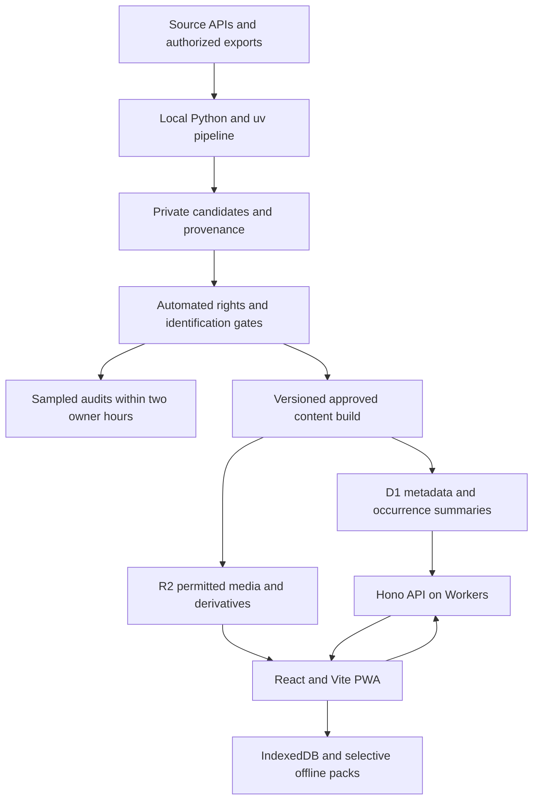

# Proposed architecture

November 15, 2026. The architecture direction is accepted; implementation remains proposed. No production runtime code or production resources exist. Local validation tooling is authorized under Phase 0.5.

## Separation of responsibilities

Acquisition runs on an owner's computer initially. Avoid cron services, queues and persistent ingest infrastructure until refresh volume justifies them. Python adapters fetch only bounded source data and write normalized JSON/CSV plus a local SQLite catalog. Later analytical extracts may use Parquet; do not add that dependency before a real dataset needs it. D1 receives compact reviewed releases, not raw historical checklists or global rasters.

Serve the Vite build with Worker static assets and route `/api/*` through Hono on the same origin. R2 holds only permitted assets under immutable content hashes. A dedicated media hostname is a future option; correct CORS, range requests and cache controls are required. Private candidates never enter a public bucket. Avoid unnecessary KV/Durable Objects/queues and dependencies on other projects.

## Proposed logical model

| Entity | Key and essential fields |
| --- | --- |
| Taxon | Stable BirdAhead UUID; eBird code; authority/version; category; accepted name; source aliases with validity intervals; split/lump relationships |
| Geography | Stable region/destination ID; parent; boundary/version; optional source hotspot IDs; separate habitat assignments with evidence |
| Source snapshot | Source, retrieval/observation window, terms URL/date, source release, query fingerprint, checksum, attribution, access/redistribution limits |
| Occurrence signal | Taxon, geography, metric kind, native bin/start/end, value/unit, numerator/denominator if known, effort coverage, quality, source snapshot |
| Media asset | Source ID/URL, canonical/source taxa, creator, rights evidence, quality/biological attributes, review state, checksum; see media policy |
| Derivative | Parent checksum, transformation recipe/tool version, bounds or clip interval, output checksum, resulting license and attribution |
| Review event | Asset, reviewer, evidence, decisions, reason, timestamps, duration, dispute/escalation; append-only |
| Content release/pack | Taxonomy/occurrence/media versions, approved IDs, checksums, geographic/time scope, attribution manifest, expiry/revocation policy |
| Learner/profile | Independent identity and settings; household sharing never merges mastery implicitly |
| Attempt | Globally unique event ID, profile/session, release/asset, species/challenge, response/confidence, information sufficiency, timestamp |
| Mastery/confusion | Profile × taxon × modality × challenge; scheduling state; directed true/answered species counts with context and uncertainty |

Foreign keys and unique source IDs enforce idempotency. Index occurrence by geography/time/taxon and mastery by learner/due date. Do not use common names as keys. Keep multiple media/challenge labels without assuming every species supports every age/plumage/vocalization cell. A failed content gate cannot be overridden by runtime selection.

## Reproducible acquisition and releases

Fingerprint source+query+adapter version, record retrieval time and raw content digest, retain private licensed captures, and checkpoint completed work. Retry transient errors with bounded backoff and respect Retry-After; stop on access challenges or unresolved rights. The current experiment CLI stops on HTTP errors and resumes completed species rather than implementing a production retry framework.

Normalize independently from downloads. Deduplicate exact bytes and source IDs, then use perceptual/audio fingerprints to propose near-duplicates. Automated gates attach source/rights/model evidence; sampled human/expert audits attach separate findings. Content build accepts only approved, unquarantined, rights-complete records and exports a portable release manifest. Publish objects before switching a release pointer; rollback selects the previous manifest. Recheck disputed/taken-down assets, disable new selection and expire downloaded packs; offline revocation cannot be immediate on disconnected devices.

Full source media, raster cubes and checklist archives stay in private portable local storage unless rights permit an R2 archive. Export D1 as SQLite/SQL and normalized JSON/CSV; export learner progress separately. R2 supports S3-compatible object access. Keep a second independent backup of irreplaceable review decisions; platform point-in-time recovery alone is not an archival strategy.

## Offline learning and two users

Precompute a deck and fetch a checksum-verified manifest plus selected assets. Store structured state in IndexedDB and media in a controlled service-worker cache. Estimate bytes, allow selective downloads, check free space and handle eviction/interrupted fetches. Packs retain attribution/license data while offline. Do not require a live third-party API to reveal an answer.

A shared session records separate attempts for each participant. Use event IDs for idempotent synchronization and explicit conflict policy for profile settings. Shared devices need obvious active-profile selection. Authentication, private life-list import and authorization design remain a future phase; never place source credentials in the PWA. Browser speech synthesis can reveal answer names later; it is distinct from synthetic bird vocalizations.

## Alternatives and existing patterns

Workers+D1+R2 suits two users and compact relational metadata. SQLite files/static JSON alone could validate a local prototype first. A larger Postgres/geospatial service adds operational cost before there is evidence of need; reconsider only for complex spatial queries or scale beyond D1. Indexed geographic summaries avoid adding a spatial database now. Native mobile development could improve long background playback/downloads, but requires more maintenance; validate PWA constraints on actual devices first.

Read-only inspection of Road Naturalist's architecture and deployment docs supports source-specific adapters, distinct evidence classes, immutable manifests, checksums, offline preparation and post-publish verification. Its raw GIS data and deployment resources are not dependencies. Deep Cuts was not found in the inspected local top-level project metadata; no reuse or compatibility assessment is claimed. Available shared skills were inspected; AWS/site-deployment skills are outside this task. No skill imposed an approval workflow.

## Cost model, in USD

Rates checked November 15, 2026; estimates are incremental, not an account invoice. Existing projects may consume shared allowances.

| Item | Verified rate or allowance | BirdAhead planning consequence |
| --- | --- | --- |
| Workers | Free dynamic allowance 100,000/day; paid starts at $5/month; static asset requests free | Two-user pilot could be $0 incremental; allow $5/month if paid plan is needed |
| D1 | Free: 5M rows read/day, 100k written/day, 5 GB account storage | Indexed compact summaries/progress should fit; free per-database limit is 500 MB |
| R2 Standard | $0.015/GB-month, $4.50/M Class A, $0.36/M Class B, free internet egress | Compute on bytes actually retained, including permitted masters and derivatives |
| R2 free tier | 10 GB-month, 1M Class A, 10M Class B monthly | Account-wide; do not assume unused allowance |
| Domain | Registration $11.17, quoted annual renewal $11.17 | Approximately $0.93/month amortized; auto-renew off |

Sources: [Workers pricing](https://developers.cloudflare.com/workers/platform/pricing/), [D1 pricing](https://developers.cloudflare.com/d1/platform/pricing/), [D1 limits](https://developers.cloudflare.com/d1/platform/limits/), [R2 pricing](https://developers.cloudflare.com/r2/pricing/), [actual registration evidence](../experiments/domain-registration.json).

Assume 3,000–4,200 delivery photos at 0.25–0.9 MB and 900–1,400 recordings at 0.5–3 MB: approximately 1.2–8.0 GB of delivery media. If permitted masters, derivatives and review versions total 20–60 GB, storage costs $0.30–$0.90/month before allowances; with an otherwise unused 10 GB allowance, $0.15–$0.75. These size distributions are assumptions; the five-file sample is too small to validate them. Long original audio and archival photographs could materially exceed them.

At 2 users × 30 sessions/month × 20 exercises, about 1,200 media deliveries plus manifests and small progress calls occur monthly. At 0.5–2 MB/exercise, budget 0.6–2.4 GB/month before cache reuse, separate from occasional offline packs. Even 10,000 object reads/month is $0.0036 at the raw Class B rate before allowances/rounding. Indexed progress and precomputed packs avoid large row scans. Target incremental hosting $0–$1/month on free/existing plans, or $5–$6/month with a new paid Workers subscription, plus domain amortization. No paid plan or bucket/database was created.

Public API experiments incurred no known provider usage charge. Human review, permission negotiations, local disk/backup and optional licensing dominate uncertainty. The original 93–280-hour per-asset review scenario is rejected by the amendment. The initial regional collection has a hard two-hour TOTAL owner-review cap, using automated gates, statistical samples and replacement/reduced coverage. Actual owner throughput is not yet measured. No assumption of free Cornell licensing or unlimited API access is built into the budget.
