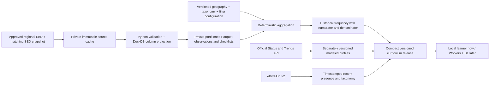

# Scalable geographic acquisition

**Phase Eight update, November 16, 2026:** the regional pipeline, bounded source adapters, real two-species S&T raster extraction and selective publication interfaces are implemented. EBD/SED availability and historical parity remain unverified. The public noncommercial intended use, measured resources, release gates and single owner request are in [the Phase Eight report](phase-eight.md) and [provider request](phase-eight-owner-request.md). The sections below retain the original dated investigation; the new report supersedes their planned/unmeasured implementation status.

November 15, 2026. **Decision: use the seven supplied histograms immediately for the local MVP; grow through a configuration-driven EBD + Sampling Event Data pipeline, with Status and Trends and recent observations kept separate.** Manual per-county downloads are bootstrap/reference work only. They are not a refresh mechanism or a prerequisite for delivering the local learner.

## What was verified

| Source | Verified capability | Current limit |
| --- | --- | --- |
| Seven owner exports | Annual county histograms, 2016–2025, 48 native bins with a sample-size row; originals preserved in ignored private storage | Aggregated references cannot reconstruct checklist effort, duplicates, individual dates or the website's full selection rules |
| EBD + Sampling Event Data (SED) | Official regional custom downloads; observation-level EBD and checklist-level SED; published monthly snapshot cadence | No EBD archive acquired. This session did not establish account/project approval, current extract size, or unattended delivery entitlement |
| Status and Trends API | `EBIRD_ST_API_KEY` available; two authenticated `list-obj` requests succeeded for Northern Cardinal and Blackpoll Warbler, documented Status version 2023 | Listing is validated; raster fetching, headers, sizes, local spatial extraction and all-25-species coverage are not yet measured |
| eBird API v2 | Prior bounded authenticated county lists, hotspot lookup, recent observations and historical-day presence succeeded; canonical taxonomy crosswalk obtained | Recent/presence endpoints do not provide annual complete-checklist denominators |

[Safe authenticated evidence](../experiments/geographic-access.json) records HTTP 200 for both species, 157 and 183 object paths, 23,028 total response bytes and zero raster bytes downloaded. Both lists contain weekly occurrence/abundance products at 3 km and a `band-dates.csv` object. They contain paths, not file sizes. The 2023 year follows the current documentation; it is not an independently discovered latest release. The EBD download page returned an access challenge in the research browser; it was not bypassed. The Status and Trends request page was unavailable to that browser, which does not invalidate the observed API authentication.

Official [download guidance](https://science.ebird.org/en/use-ebird-data/download-ebird-data-products) describes monthly EBD releases on the 15th and a project request, typically approved within seven days. [eBird's data-format guide](https://support.ebird.org/en/support/solutions/articles/48000838205-download-ebird-data) distinguishes EBD observations, SED checklists and the limited recent/summary API. GBIF's annual occurrence-only EOD omits effort and is unsuitable as the denominator source.

## Acquisition architecture — proposal



Each region configuration names source coverage, year range, taxonomy release, county codes, hotspot IDs or a versioned polygon, native bin scheme, effort filters, minimum support and fallback region. A boundary has a source URL, license, checksum and CRS. New counties or destinations inside a cached regional extract require configuration and aggregation, not another download. Illinois/Kentucky expansion requires source coverage for those states, not relabeling Indiana data.

Start with a southwestern Indiana regional EBD/SED extract for all taxa and all months, 2016–2025, preferably a bounding region that also covers the intended Illinois/Kentucky corridor. If custom selection cannot express that region, use an approved broader Indiana/Illinois/Kentucky extract and filter locally. Obtain the same release, date scope and geography for EBD and SED. Do not request only the 25 teaching species in a way that reduces the SED population to checklists where one was detected. Cache approved archives once; preserve provider documentation, grant/terms version, release, acquisition timestamp, checksums and expected byte counts privately.

**Unattended EBD access is an unresolved provider integration, not a reason to scrape.** The reviewed official references document request/download workflows, not a public bulk-download API or stable refresh URL. Do not invent an endpoint or automate an authenticated website. The scalable delivery option is provider-supported recurring regional delivery or documented programmatic access under the account's grant. A downloader may consume authorized direct download URLs with expiry handling if Cornell provides that route; it must not assume those URLs remain stable. Until that is arranged, a single approved broad snapshot supports automated generation for many locations and a useful cached MVP, with an explicit vintage. It does not establish unattended future refresh. If refresh is unavailable, keep the historical vintage, refresh recent presence through API v2 and document staleness. Never revert to recurring county histogram requests.

## One-time owner setup, without per-county operations

1. Sign in at [eBird Download Data](https://ebird.org/data/download), check whether this BirdAhead project already has EBD access, and submit one project request if needed. Use the consolidated [public noncommercial educational intended-use description and regional request](phase-eight-owner-request.md), including anonymous educational access, private raw storage, all-taxa complete-checklist denominators and automated geographic expansion.
2. Ask for one coherent regional EBD **and matching SED**, all months, 2016–2025 for validation, accepted/vetted observations, and surrounding intended geography. Select **Include sampling event data**. Exclude provisional/unvetted records in the first operating profile. Save the delivered documentation, release information and terms with the archives under `experiments/private/geography/ebd/`.
3. In that same request, ask which supported delivery mechanism permits unattended refresh of a regional extract, what request limits apply, and whether versioned direct URLs or recurring delivery are available. Ask about public noncommercial educational derived-profile distribution, offline packs, S&T web/app consent, required attribution and submission of derived products. A normal `EBIRD_API_KEY` or `EBIRD_ST_API_KEY` is not an EBD grant.
4. Do not send credentials or download links through project documentation. A supported credential, if issued, belongs in the shared credential file. No further owner histogram downloads are planned. This setup can run alongside local use of the seven supplied files.

These are actionable access steps, not a claim that Cornell offers a recurring delivery service. No contact message was sent on the owner's behalf.

## Historical aggregation contract

The following is BirdAhead's proposed deterministic contract, to be frozen with each release and compared with the bootstrap references. It is not a claim to reproduce unpublished website logic.

- Create one eligible checklist population from SED: accepted snapshot, configured geography/date/effort rules, `ALL SPECIES REPORTED` true. Retain checklists with no detections of pilot species. Use stable sampling-event IDs, including complete lists with no bird rows where the source includes them.
- Resolve shared-group duplicates to one independent birding event, deterministically; retain the contributing IDs. Group-member disagreements about completeness/location require an explicit conflict policy and counters, rather than choosing different members independently for numerator and denominator. Apply exactly the same selected-event population to EBD detections.
- Map source taxon concepts through a versioned, reviewed taxonomy crosswalk. Roll subspecies/infraspecific records to a defensible species parent; count at most one detection of that species per event. Quarantine ambiguous slash taxa, hybrids and unresolved split/lump mappings. Never infer a species detection from a slash record. Presence recorded as `X` is a detection with unknown abundance, not zero individuals.
- For geography `g`, bin `b`, species `s`: `n(g,b)` = eligible distinct events; `k(s,g,b)` = those events with a valid detection. `frequency = k / n`. Preserve integer `k` and `n`, not only rounded rates. Keep `n = 0` as missing frequency; positive `n` with `k = 0` is a supported non-detection. Species outside the source/taxonomic coverage remain missing, not zero. Empty/not-yet-imported partitions and failed filters have explicit status.
- County membership follows source region codes for the reference comparison. Hotspots use locality IDs and documented groupings. Polygons use spatially indexed checklist points with a recorded inclusion rule. Traveling/hotspot coordinates approximate a visit, not the exact location of each bird; small arbitrary polygons need stricter effort/distance bounds or parent-region fallback.
- Store native temporal boundaries and calendar conventions. Histogram reference bins, configurable rolling windows and S&T weekly bands are different calendars. Do not rename 48 reference bins as 52 weeks. A rolling profile is separately derived from daily event dates, with window width, leap-day handling and effective sample support recorded.
- Publish observer/event/day support, effort distributions and coverage alongside frequency. A simple binomial interval does not account for repeated observers, shared events or habitat-selection bias; label it accordingly if provided. Do not turn checklist frequency into an absolute encounter probability.

Cornell's [best-practice guide](https://ebird.github.io/ebird-best-practices/ebird.html) establishes complete-list non-detections, shared-list handling, taxonomic rollup and effort/spatial limitations. The reference profile should first use a documented, minimally filtered complete-checklist population. A separate effort-restricted profile may use stationary/traveling counts with explicit duration/distance/observer limits. Both remain descriptive reporting frequencies. Changing effort filters changes the denominator and requires a new profile/version; it does not silently “correct” the reference.

## Validation against the seven histograms

Preserve each original byte-for-byte with SHA-256, filename scope, parsed values and unresolved labels. Use the actual 2016–2025 scope, native bins and sample sizes from these references. First compare EBD-derived `n` by county/bin with the sample-size row; then compare species rates, including winter visitors, breeding visitors and narrow migration windows. If sample sizes differ, investigate snapshot date, website filtering, incidental/incomplete lists, shared events, taxonomy and exotic/provisional policies before comparing rates.

For a genuinely matched scope, compare unrounded `k/n` to export precision, with an explicit tolerance based on source rounding. Do not manufacture `k` by multiplying a rounded histogram frequency by sample size: any source floor/suppression/rounding must remain visible. Record maximum/median rate discrepancy, numerator consistency and denominator mismatch separately. The imported files validate parsing and seasonal behavior today. **EBD-to-histogram parity is not yet measured because no EBD/SED extract was acquired.** A parser passing synthetic checklist tests does not establish parity.

## Status and Trends — separate modeled lane

The official [API vignette](https://ebird.github.io/ebirdst/articles/api.html) documents Python-compatible list and fetch endpoints:

```text
GET https://st-download.ebird.org/v1/list-obj/{version_year}/{species_code}?key={secret}
GET https://st-download.ebird.org/v1/fetch?objKey={object_path}&key={secret}
```

These are documentation placeholders, never shell commands containing real credentials. Load `EBIRD_ST_API_KEY` through `tooling.discover.credential`, respecting environment overrides. Construct URLs only in memory; suppress query strings, redirects, response bodies and exception messages in logs. Cache by public object identity/version, never authenticated URL. Disable verbose HTTP tracing. Apply redirect allowlists and do not forward credentials to unrelated hosts.

Proposed next bounded step: inventory the retained 25 codes at a pinned documented release, select only required products, inspect size headers where supported, then fetch one small metadata object and one explicitly budgeted coarse raster before committing to 3 km cubes. Preserve product-specific dates from `band-dates.csv`, projection, units, resolution, modeled/assumed zero versus `NA`, quality masks and source release. Avoid default “download everything” behavior. A list result is evidence of accessible paths, not evidence of usable local modeled values.

[Status product documentation](https://ebird.github.io/ebirdst/articles/status.html) describes 52-layer GeoTIFF cubes, 3/9/27 km grids and standardized modeled estimates. These are conditioned on a specified expert observer/effort scenario, unlike historical checklist proportions. Aggregate valid cells with area weights over the requested region, reporting valid area and spatial resolution. A tiny hotspot does not acquire hotspot precision from a 3 km cell. Preserve no-estimate cells; do not impute them to zero. S&T can identify approaching modeled migration windows independently of today's observed frequency. It supplements, rather than substitutes for, the descriptive historical lane. Annual releases must not be treated as a time series without methodological compatibility checks.

The [species metadata reference](https://ebird.github.io/ebirdst/reference/ebirdst_runs.html) provides release and seasonal quality fields; missing/failed seasons must stay unavailable. The [download function reference](https://ebird.github.io/ebirdst/reference/ebirdst_download_status.html) supports selecting files and dry runs. Python can use the API directly; an R runtime is not required for BirdAhead.

## Python, DuckDB and Parquet — proposed local engine

Use uv-locked Python orchestration, DuckDB SQL for bounded column projection, deduplication and grouped counts, and private Parquet as the portable intermediate. Avoid loading a regional TSV into pandas. Read explicit source column types; preserve source strings/raw values when conversion is uncertain. Set a measured memory budget (initial proposal 4 GB on this 16 GB Mac), thread count and private spill directory; prevent inference jobs from competing with bulk processing. Stage scans, joins and aggregates separately when necessary. DuckDB supports [disk spilling but still has memory limits](https://duckdb.org/docs/2.0/guides/performance/how_to_tune_workloads); benchmark actual extracts before promising throughput.

Initially partition observations/checklists by snapshot, year and coarse region/state, sort within partitions by date/location/taxon as useful, and project only required columns. Do not create species × hotspot × week directories. Compact small partitions; tune row groups using actual scans. DuckDB's [partition guidance](https://duckdb.org/docs/2.0/data/partitioning/partitioned_writes) warns against many small files. Use DuckDB spatial or a separate pinned geometry library for polygon joins after a bounding-box prefilter; spatial extension installation and boundary acquisition remain future validation, not measured capabilities here.

Make releases immutable and manifests content-addressed. Cache keys include snapshot, source hashes, taxonomy crosswalk, geometry hash, filter configuration, calendar and code/lock revision. Build in a temporary directory, verify row counts/uniqueness and atomically publish a manifest. Resume completed partitions only when their input hashes match. Rebuild affected partitions after checklist edits/deletions or taxonomy changes. Full replacement snapshots are authoritative; do not append them as deltas. “Last edited” filters can reduce recomputation when available but cannot reveal deletions by themselves. Periodic reconciliation is required. API v2 recent data refreshes can be daily/cached with conservative request budgets; they never patch the historical denominator.

Only compact species × location × bin summaries and provenance references belong in the runtime database. Keep bulk observations, SED, model cubes, temporary spills and sensitive coordinates out of D1, browser bundles and Git. The local MVP reads a private compiled release with no live third-party calls. Workers/D1/R2 remain a later deployment decision.

## Size and cost preflight

**Measured:** the seven source sample-size rows sum to 79,868 across the ten-year scope, with county/bin counts ranging from 13 to 1,226. This is a website reference count, not an inventory of EBD rows or proof of shared-event deduplication. The two S&T lists cost 23 KB of metadata transfer; byte lengths of their rasters were not supplied.

**Planning estimate, not a quote or benchmark:** assuming 20–50 taxon rows per reference checklist and 500–1,000 raw bytes/observation gives approximately 1.6–4.0 million rows and 0.8–4.0 GB of TSV for a roughly comparable seven-county complete-list extract, before incomplete lists, broader coverage and snapshot differences. Reserve several times projected raw size for archives, Parquet, a replacement snapshot and spill; a 20 GB free-space target is a provisional small-region starting point, not enough assurance for three whole states. Inspect actual authorized archive `Content-Length`, decompression ratio, headers and a bounded sample before any download ceiling is raised. Avoid relying on old global EBD size figures, which official examples themselves date to earlier releases.

S&T cost grows with species × product × resolution, even when the requested county is small because an object may be a global cube. Do not assume remote range requests, cloud-optimized layout, server-side clipping or archive resumability without testing. A measured regional raster clip can be cached once and reused for many configured regions. Local storage/compute have no new hosting subscription; electricity, owner time and available disk are not measured. Set per-run byte/time budgets and stop on unknown oversized objects. Current validation made no purchases, no raster or EBD bulk downloads, and no cloud provisioning.

## Rights, provenance and next gate

The [official data-use summary](https://support.ebird.org/en/support/solutions/articles/48001078113) permits noncommercial research/education under its terms, restricts passing on raw downloads, requires attribution and describes submission of derived products. Preserve the actual EBD grant/terms privately and meet its intended-use restrictions. The [S&T terms](https://science.ebird.org/en/status-and-trends/products-access-terms-of-use) are separate, covering modified products too; the research browser could not retrieve the full current text. A working key is not a blanket public redistribution or commercial-use grant. Keep acquired originals and full modeled products private, record required product citations and resolve intended delivery terms before wider distribution. No media permission follows from either dataset grant.

**Go now:** use the seven supplied references and existing accepted media for the local learner; ship visible vintage/support and separate current/approaching priorities. **Continue independently:** obtain one approved broad EBD/SED snapshot and provider-supported refresh route, validate DuckDB aggregation against all seven counties, and budget a single S&T raster experiment. **Not yet demonstrated:** unattended EBD refresh, EBD/reference parity, real bulk throughput, raster byte/storage requirements and all-regions biological precision. These limit future automated geographic freshness, not the usefulness of the local bootstrap application.

## Implemented bounded checks after research

The seven files are now imported with source hashes, 8,400 pilot rows, 48 native intervals, 79,868 reference samples and conservative null treatment for 72 possible-marker cells. See [the import/seasonal report](phase-one.md). The local learner is implemented and does not wait for bulk delivery.

`tooling.checklists` now provides a bounded source-shaped EBD/SED kernel with explicit scientific-concept crosswalk, complete-list denominators, shared-event conflict handling, distinct species detections, separate county/hotspot configurations, zero-support missingness and private Parquet output. The default 50 MB input ceiling is intentional. Tests use synthetic checklists, not actual EBD. [Pilot configuration](../config/geography/pilot.json) leaves source versions null and crosswalk review pending; those must be established before real processing. Polygons, effort strata, unattended delivery and EBD/reference parity remain proposed/unverified.

The real bootstrap-only DuckDB 1.5.6 check wrote/read 8,400 imported rows in seven Parquet county partitions (93,414 bytes) in 0.0305 seconds. This tiny-data result is not a bulk scan/spatial benchmark. [Evidence](../experiments/duckdb-validation.json).
