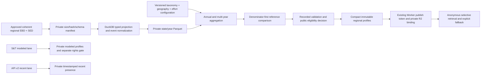

# Phase Eight — Scalable geographic intelligence

**Continuation, November 20, 2026:** the owner reports eBird approval, but its documentation and a matching regional EBD/SED delivery were unavailable locally. Scope, public eligibility and real-source validation remain unverified. See the [continuation measurements and release gate](phase-eight-continuation.md) and [approval handoff checklist](phase-eight-owner-request.md#approval-handoff--november-20-2026). The original November 16 findings below remain dated evidence.

November 16, 2026. **Implemented and tested architecture; historical expansion and geographic deployment remain blocked on the approved regional EBD/SED pair and public-use evidence.** Phase Seven `b9e848a` is the accepted baseline. No new media, geography claims in the live learner, infrastructure or paid services were introduced. See the [expansion manifest](../config/geography/expansion.json) and [one consolidated owner request](phase-eight-owner-request.md).

## Access and resource findings

Evidence labels distinguish **verified documentation**, **observed experiment**, **proposal**, **assumption** and **blocked/unavailable**. Authenticated raw responses, points and rasters remain in ignored private storage. Credentials were checked programmatically with environment precedence; their values, authenticated URLs and exception bodies were not logged.

| Source | Observed experiment, November 16 | Boundary |
| --- | --- | --- |
| EBD + matching SED | No matching archives found under the project private cache, Downloads or Documents; eBird v2 and S&T keys available | Account/project approval and approved portal delivery unverified. No authenticated page scraping, guessed endpoint or EBD transfer. Actual regional archive size and throughput unavailable. |
| S&T documented authenticated API | 2 fresh inventories, 340 object identities; four weekly occurrence/abundance 27 km rasters plus two calendars and two config files downloaded | 2023 is the documentation-pinned Status vintage, not a claim to discover the latest release. 18 requests, 5,744,120 response-body bytes, zero failed requests, no retries. |
| API v2 recent | One US-IN request, `back=7`, `maxResults=5`: HTTP 200, 1,520 bytes, 5 records | Presence sample only. It cannot supply complete-checklist denominators or a statewide all-time inventory. Raw response remains private. |
| Existing histograms | Seven files, 737,866 bytes, 79,868 reference samples over 48 bins, 2016–2025 | Reference inventory is real; EBD denominator/frequency comparison unavailable. Source taxonomy vintage remains unknown. |

[Access/transfer/extraction evidence](../experiments/phase-eight-modeled.json), [recent evidence](../experiments/phase-eight-recent.json), [resource measurements](../experiments/phase-eight-resources.json), [reference validation status](../experiments/phase-eight-validation.json).

**Verified documentation:** EBD observations and checklist-level SED have distinct roles; regional project request/direct download is supported and the EBD updates monthly. No reviewed documentation established an unattended regional EBD API. Ordinary v2 access and S&T access are independent of an EBD grant. [Provider download guide](https://support.ebird.org/en/support/solutions/articles/48000838205-download-ebird-data), [official S&T API](https://ebird.github.io/ebirdst/articles/api.html).

The [S&T terms PDF dated November 15, 2023](https://is-ebird-wordpress-prod-s3.s3.amazonaws.com/wp-content/uploads/sites/55/2021/07/eBird-Status-Trends-Terms-of-Use-2023-Updates_20231115_FINAL.pdf) was readable when the usual terms page was unavailable. Sections 3(b) and 3(d) distinguish educational materials from web/app use; the more restrictive applicable case requires prior written consent for data-product use and redistribution in websites/apps. **Inference for BirdAhead:** keep modeled outputs private until this scope is confirmed in writing. A working API key is insufficient. The combined owner request includes this permission; no message was sent. Historical profiles separately follow [EBD terms](https://www.birds.cornell.edu/home/ebird-data-access-terms-of-use/) and the actual project grant.

**Observed local resources:** 17,179,869,184 bytes physical memory (16 GiB), 8 logical CPUs, 494,384,795,648-byte filesystem. Initial pre-download inspection found 123,139,780,608 bytes free; the recorded post-install/acquisition preflight found 123,035,537,408 bytes. That change includes dependency installation and other local activity; it is not a source download size measurement. Four rasters total **5,685,505 bytes** (1,076,095–1,774,926 bytes each). Source HEAD sizes were measured before GET. Neither `ETag` nor `Accept-Ranges` was advertised by the tested S&T fetch responses; safe resume was therefore **not established for this provider**.

Defaults: 64,000,000 bytes downloaded per run; 500,000,000 combined expanded input bytes; 20,000,000,000-byte free-disk reserve; DuckDB 2,048 MB, two threads, 4,000,000,000-byte spill cap. Acquisition preflights both EBD/SED artifacts before GET, reserving expanded-input and spill space. Transfers stream to private partial files, stop on unknown size/HTML/ceiling, verify pinned checksums and only resume a byte-range response with an unchanged strong ETag and exact range. There are no automatic retries or budget increases. ZIP/gzip expansion has its own ceiling and never extracts member paths. Limits are configurable; a larger Indiana artifact requires a new measured plan, not an automatic ceiling increase. No worldwide EBD or unrestricted raster collection was acquired.

## Reproducible historical processing

The uv lock pins DuckDB, Shapely and Rasterio/numpy. [Engine](../tooling/geographic_engine.py), [source/preflight commands](../tooling/geographic_sources.py), [safe transfers](../tooling/geography_io.py), [snapshot template](../config/geography/snapshot.example.json), [bounded reference-pilot configuration](../config/geography/reference-pilot.json), [whole-Indiana configuration](../config/geography/indiana.json).



Sources must provide one snapshot identity, years, state and complete state/county scope, all species/all months, grant evidence, terms, source and target taxonomy versions, per-file sizes and hashes. The template intentionally has null unknowns and fails closed. A county extract cannot silently support a statewide profile. Put a completed copy next to private inputs; do not fill it with invented release metadata.

The processor projects explicit TSV source columns as strings and explicitly converts dates, completeness, quality, coordinates and effort. Invalid identities, malformed counts, scope violations, ambiguous mappings, mismatched snapshot members and EBD rows missing from SED fail closed. Raw source fields are not exposed to runtime. Large tables stay in DuckDB, with a private on-disk working database and bounded spill rather than a Python/pandas list.

SED establishes the population before target species selection, including complete checklists without selected detections. Shared groups count once only when completeness, date, location and effort agree; conflicting/incomplete groups are held with counters. Detections are the distinct union of approved, positive/`X` observations over agreeing members, reconciled by reviewed scientific concepts. Subspecies can roll to a documented parent. Slash/split/lump uncertainty and unmapped taxa are recorded in private taxonomy holds; they never become inferred species detections. Crosswalk columns are `scientific_name,species_code,decision,rationale`; decisions are `accepted`, `unresolved`, `excluded`.

Profiles preserve integer `detections`, `sample_size`, day support and contributing-checklist support. Binomial inference and absolute encounter probability are not claimed. Each calendar year and a pooled multi-year product use **48 native month periods**, days 1–7, 8–14, 15–21, 22–month-end; leap dates stay in their native month period. Multi-year frequency pools counts; it does not average annual percentages. Positive effort/zero detections remains zero. Zero support has null frequency; low support retains the measured rate but is marked `insufficient_support` and cannot supply a supported recommendation. Taxa outside the accepted crosswalk have no invented zero profile.

County/state/hotspot IDs use source fields. Configurable parks, refuges, travel destinations, arbitrary regions and coarse cells use the same selectors: source IDs, half-open bounding cells or pinned licensed WGS84 Polygon/MultiPolygon. Polygon membership excludes boundary points; coordinates approximate checklist visits, especially traveling lists. Boundary CRS, canonical geometry hash, source URL and license are required. Bounding filters precede point membership; state/year partitions permit pruning. Small areas should use explicitly restrictive effort filters or parent fallback. None of these selectors promises fine habitat or individual-bird precision. Public output carries no point geometry or event IDs.

Incremental behavior is explicit: source/schema/code/lock/taxonomy hashes identify immutable normalized snapshots, so geography or effort changes reuse normalization. Exact builds are reused after artifact integrity verification. Replacement snapshots get an authoritative full scan, so deletions are not missed; identical sorted Parquet partitions share content-addressed storage. This is snapshot/configuration caching and partition storage reuse, **not a claimed provider delta feed or a benchmark of nationwide incremental recomputation**. Builds stage privately and atomically rename only after invariants pass. Failed staging is removed; interrupted transfers retain only their separate private partials. Source manifests and deterministic output hashes allow reproducible rebuilds.

## Validation and measured limitations

`tooling.geographic_validation` inventories the seven real references offline. With an actual build it first compares integer county/bin denominators over the identical year scope, then compares available species frequencies only for counties whose denominators match. It records scope/support differences separately, missing/held reference cells, maximum/median absolute rate differences and the explicit `5e-7` source-rounding tolerance. It never reconstructs an integer detection count by multiplying rounded exports. Investigate source vintage, complete/effort/provisional selection, taxonomy, shared events and rounding/presence markers before accepting discrepancies.

**Blocked/unavailable:** there is no real EBD/SED denominator table to compare. No EBD parity, count difference, statewide historical coverage, full-state runtime, peak memory or national throughput claim is made. The existing seven histograms are unchanged; no additional downloads are requested. The older tiny histogram-to-Parquet benchmark is not a bulk-source benchmark.

Synthetic integration tests cover complete nondetections, union/deduplication, ambiguous taxa, shared conflicts, mismatched scope, orphan observations, low/zero support, annual/month-end alignment, effort selection, polygons, deterministic rebuilds, cache reuse and changed configurations. Transfer tests cover resume, unsafe hosts, unknown/oversized sources, HTML challenges, disk and expansion limits. Synthetic fixtures cannot pass public compilation. These tests demonstrate implementation behavior, not biological accuracy or reference parity.

## Modeled lane findings

[Raster adapter](../tooling/modeled_geography.py) uses only the documented inventory/fetch endpoints. Inventory families include weekly/seasonal products, range data, quality/performance diagnostics and metadata; the experiment selects only the exact listed two-species weekly median occurrence/abundance 27 km identities plus calendars/config. It never defaults to downloading all products. Native dates and config quality/season metadata stay with each private result.

Four rasters each expose 52 weekly bands in equal-area **EPSG:8857**, 27,000 m grid cells. A deliberately coarse southwestern Indiana envelope `[-88.1, 37.75, -86.6, 39.3]` is transformed to the product CRS and intersected by cell area. This is an approximate destination envelope, **not an Indiana or county polygon**; it includes neighboring territory. Valid modeled cells are area weighted; nodata/nonfinite cells remain unavailable, and valid area fractions are retained. The raster nodata value and source resolution are preserved separately from quality scores. Provider quality fields are metadata, not probabilities or independent local validation.

Observed values are standardized model estimates for the provider expert-observer, one-hour/two-kilometre scenario. The outputs preserve `modeled_occurrence` and `modeled_abundance` independently; 52 model weeks are never remapped to 48 historical periods. Cardinal provides broad resident context and Blackpoll provides migration context, including modeled zero weeks. The measured pilot establishes that useful coarse modeled coverage can be extracted locally before EBD is available. It does **not** establish all-species coverage, precise destination forecasts, suitability for every seasonal range, or public permission. Written web/app consent, citations/DOI and disclaimer remain release gates. No model values were added to the live learner.

## Destination and publication architecture

Road Naturalist was inspected read-only: `scripts/build-regional.py` and `src/discovery/regional-catalog.js`. Its useful patterns are immutable versioned partitions, content hashes, a coarse cell scheme and distinct empty/unpublished/partial coverage. BirdAhead adopts those design principles locally. Its Portland-area source coverage does not supply Indiana bird data, and no code dependency, source dataset, resource, credential or shared service was imported or modified. Licensed boundary acquisition and large spatial throughput remain unmeasured; explicit configured geometries work in integration tests.

`tooling.geographic_release` accepts only real EBD/SED builds, seven measured reference comparisons, a recorded discrepancy/coverage review tied to the validation hash and build identity, and an explicit attributed public-noncommercial decision. It serializes an allowlist of compact historical fields; raw source manifests, exact points, checklists, private grant references and taxonomy holds cannot enter the package. Example decision fields are documented in the runbook below. New locations and source filters cannot inherit old validation decisions accidentally.

The existing publisher accepts `--geography-package`, verifies package bytes/hashes, uploads each selected compact object under `releases/geography/<version>/<region>.json` via the publish-token-authenticated, rate-limited Worker binding and attaches the index to a **new** content release identity while preserving learner compatibility. No raw-data publisher exists. Existing activation/rollback pointers remain the release mechanism; R2 remains private. Without a package the established catalog path is unchanged.

The Worker offers `/api/public/geography` and `/api/public/geography/<version>/<region>` only for regions explicitly present in the active eligible catalog. It never accepts an arbitrary R2 key, and verifies object bytes/checksums before anonymous immutable delivery. The optional browser module lazily retrieves one selected region, uses anonymous versioned HTTP caching, coalesces simultaneous requests and checks integrity. A sparse species/bin follows the index's explicit parent chain; the result records requested/effective region. Unsupported roots return missing. The existing user interface remains on the accepted seven-county data until an eligible expansion release exists.

Discovery, teaching eligibility and accepted-media availability remain independent. The engine has no media prerequisite; a new discovery species does not acquire quiz media by being detected. Existing guest practice, optional household progress, selective offline packs, Road Trip, SEO and CFLab analytics remain intact. This change adds no analytics events, identity/coordinate collection, alternate-host access or nationwide browser payload. New geography UI/offline-pack selection can consume the optional interface after real expansion is released; the existing packs and Road Trip are not migrated to unvalidated sources.

## Operations and rollout

Offline/default commands:

```sh
uv sync --locked
uv run python -m tooling.geographic_sources preflight
uv run python -m tooling.geographic_validation
uv run python -m tooling.modeled_geography
```

After the one approved regional source delivery, save an ignored acquisition plan with `grant_reference`, `snapshot_id`, `states`, `all_species`, `all_months`, explicit `approved_hosts`, and `artifacts.ebd`/`.sed` containing provider-supplied `url`, `filename`, `sha256`, `snapshot_id`. URLs remain private. No command line or public config contains a signed URL. Use explicit ceilings; defaults intentionally may reject a regional artifact until its actual size has been reviewed.

```sh
uv run python -m tooling.geographic_sources acquire --plan experiments/private/geography/plan.json --output experiments/private/geography/ebd
uv run python -m tooling.geographic_sources unpack --source experiments/private/geography/ebd/approved.zip --output experiments/private/geography/ebd/approved.txt
uv run python -m tooling.geographic_engine --snapshot experiments/private/geography/ebd/snapshot.json --config config/geography/reference-pilot.json
uv run python -m tooling.geographic_validation --build experiments/private/geography/engine/builds/BUILD_HASH --output experiments/private/geography/validation.json
```

Complete the snapshot template with the actual source pair and reviewed crosswalk. Use `reference-pilot.json` for a seven-county source and `indiana.json` only for a complete Indiana source. A publication decision must contain the exact `build_identity`, `validation_sha256`, `validation_decision: accepted_with_recorded_limitations`, `validation_rationale`, `public_noncommercial_eligible: true`, `terms_url`, `attribution`, `public_use_basis`, `reviewed_by`, `reviewed_at`, `approved_regions`, and optional public `public_limitations`. Keep grant/review evidence private. This is a data-release gate, not another mandatory owner media audit.

```sh
uv run python -m tooling.geographic_release --build experiments/private/geography/engine/builds/BUILD_HASH --validation experiments/private/geography/validation.json --decision experiments/private/geography/decision.json --output experiments/private/geography/package
uv run python -m tooling.cloud_publish --geography-package experiments/private/geography/package --dry-run
```

**Proposal:** after real validation and eligibility, publish staged regional products and activate only through the established verified release process. Follow Indiana with Illinois and Kentucky by adding source coverage and configuration, then expand using the same state/year pipeline. No state-specific ingestion branches are needed. Source updates require coherent replacement snapshots, not repeated county downloads or recent-record patches to historical denominators.

The repository variable `CLOUDFLARE_DEPLOY_ENABLED` was observed `true` and set to **`false` on November 16, 2026** before this change was pushed. No deployment was performed. No production backup, rollback, token-scope, D1/R2 or shared resource change was necessary; no credentials were rotated. Future content rollback selects the previous catalog pointer and retains compatible progress and immutable media. Keep the geographic package and prior manifest available for reproducibility. The only unavoidable external owner action is the consolidated provider request above.

Local verification completed: **77 Python tests**, **28 application tests**, TypeScript/Vite production build, Worker bundle dry run and unchanged 589-object publisher dry run passed. The geographic fixtures, transfer failure/resume cases and raster nodata checks are offline; only the explicitly reported S&T and recent experiments made source requests. No source acquisition was repeated for formatting or tests. Publication remains staged/unavailable until real-source and rights gates are met.
